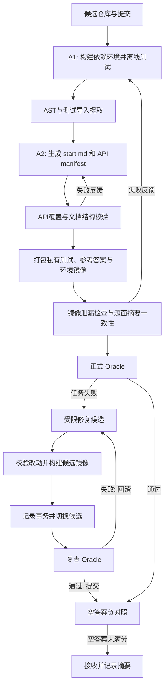

# SWE Instance Factories

本项目包含按三份只读规格独立实现的构造器：

| 构造器 | 入口 | 当前实现与实测边界 |
| --- | --- | --- |
| NL2Repo | `python -m nl2repo_factory` | 原有第一版；TagKit 宿主示例与组件测试 |
| DeepSWE 风格 | `python -m deepswe_factory` | A-existing 消融、B Base+演化、C query/testcase/solution；三路线人工示例及导出验证器实跑 |
| ProgramBench | `python -m programbench_factory` | 构建、字节探测、测试展平、dummy/gold QC、独立 Docker 重建接口；C CLI 人工示例实跑 |

三份原始文件 `nl2repo.md`、`deepswe.md`、`programbench.md` 保持只读，修改设计和实现时使用新增文件。
新构造器的完整使用方法、输入契约和规格差异见 [复现说明](docs/factory_reproduction.md)。
宿主示例不代表真实模型构造、Docker 隔离或目标 Harbor 平台已验证。

```bash
.venv/bin/python -m deepswe_factory demo --output runs/deepswe-demo-next
.venv/bin/python -m programbench_factory demo --output runs/programbench-demo-next
.venv/bin/python -m unittest discover -s tests
```

输出路径必须尚不存在。以下保留 NL2Repo 的原有使用说明。

本次本地验收记录：[173 项测试及原始规格完整性](runs/factories-verification-01/verification.json)、
[DeepSWE 三路线示例](runs/deepswe-demo-02/summary.json)、
[ProgramBench C CLI 示例](runs/programbench-demo-02/summary.json)。
这些记录均明确标记没有真实模型调用或 Docker 执行。

## NL2Repo Factory

依据 [nl2repo.md](nl2repo.md) 独立实现的第一版 instance 构造流水线。
本节描述 NL2Repo 构造器；另外两种构造器见上方入口。

## 已实现的核心流程



基础设施错误有独立重试预算；过滤、构造失败、缺失分数、超时、未验证产物和正式接收分别记录。
当前调度为单仓库串行，可在一个 JSONL 中顺序处理多个候选。

| 模块 | 职责 |
| --- | --- |
| `source.py` | JSONL、URL、task ID、范围选择 |
| `ast_scan.py` | 不执行仓库代码的 AST、目录树、API 和测试导入证据 |
| `specification.py` | 文档测试树清理、API 覆盖、行为节点和文件数门禁 |
| `agents.py`、`prompts/` | 工具型 Agent CLI 接口；A1、A2 和同一 Agent 的修复任务书 |
| `packaging.py`、`verifier.py` | 最终任务目录、私有资产、独立验证脚本与文档规定的评分器 |
| `docker.py`、`oracle.py` | 镜像构建/归档/检查；断网容器中的 Oracle 和空答案验证 |
| `repair.py` | 冻结文件、测试/命令约束、分母修正、双资产提交/回滚及恢复日志 |
| `pipeline.py` | 阶段连接、反馈路由、重试、证据和最终接收状态 |

## 当前验证范围

- 确定性组件、实际子进程接口、模拟外部适配器的主流程与事务故障恢复均有测试。
- `demo` 用真实 pytest 和生成的独立 verifier 执行 TagKit：完整实现 `1.0`，空实现 `0.0`，缺少类型检查 `0.75`。
- TagKit 是原规格第 15 节的人工示例，题面来自文档；没有调用模型生成它。
- 开发机器没有 Docker，因此当前未实际执行镜像构建、Docker Oracle 或真实模型构造。
- 宿主 demo 不证明容器隔离，也不产出可接收的生产镜像。`summary.json` 明确记录这些边界。

## 本地使用

运行时 Python >=3.11，主体只依赖标准库。开发测试使用 Python 3.12；AST 显式采用 3.11 语法。
`demo` 额外需要 pytest。当前工作目录已建立 `.venv` 并安装项目和 pytest，可以直接运行：

```bash
.venv/bin/python -m unittest discover -s tests
.venv/bin/nl2repo demo --output runs/tagkit-demo-next
```

每次 demo 使用一个不存在的新目录，保留先前证据。首次换机器安装可用：

```bash
uv venv --python 3.12 .venv
uv pip install --python .venv/bin/python -e . pytest
```

不接模型也可以独立调用：

```bash
.venv/bin/nl2repo scan nl2repo_factory/fixtures/tagkit/repo --output runs/tagkit-ast.json
.venv/bin/nl2repo check \
  --start nl2repo_factory/fixtures/tagkit/start.md \
  --manifest nl2repo_factory/fixtures/tagkit/api_manifest.json \
  --ast runs/tagkit-ast.json
.venv/bin/nl2repo score runs/tagkit-demo/cases/broken/logs/test-stdout.txt \
  --total 4 --test-file tests/test_api.py
```

## 接入真实构造

使用 [examples/nl2repo.toml](examples/nl2repo.toml) 填写路径和工具型 Agent 的启动参数。
配置相对路径基于 TOML 所在目录解析。主运行命令：

```bash
.venv/bin/nl2repo run \
  --config examples/nl2repo.local.toml \
  --repo-jsonl examples/repositories.jsonl \
  --limit 1
```

候选最小格式为 `{"full_name":"owner/repo"}`；也保留原文档 `url/html_url/clone_url` 优先级。
可添加 `commit` 锁定 Git revision。新增的 `local_path` 支持已经取得的本地仓库，路径相对 JSONL：

```json
{"full_name":"owner/repo", "commit":"a-full-commit-sha"}
```

Git 本地来源在指定 commit 时独立 clone，避免修改原仓库；未指定 commit 的本地来源复制工作树，
保留未提交内容并记录观测到的 HEAD。没有 Git 元数据的本地目录不接受 commit 参数。
URL 身份算法仍只基于 URL，因此相同 URL 的不同提交需要分开的 dataset/images 输出根。

工具 Agent CLI 必须自行具备文件读写、命令执行与观察结果的循环能力。适配器的协议为：

1. 每次调用生成 `request.json`、`prompt.md`，将 prompt 送入 stdin（可配置关闭）。
2. 设置 `NL2REPO_ROLE/REQUEST/RESPONSE/PROMPT/WORKSPACE`；argv 也支持同名小写 `{placeholder}`。
3. CLI 在指定工作目录执行，将最终 JSON 写入 response 文件，或者输出到 stdout。
4. 保存 stdout、stderr、退出码、超时和解析后的响应。非零退出和超时不能凭成功 JSON 通过。

`request.json` 中有角色、路径、完整 prompt 和阶段输入。A1/A2/修复使用同一配置的 CLI，
通过 role 区分任务；模型服务和认证可由 CLI 已有配置或进程环境提供。
这里没有假定某家服务特有的 CLI 参数，示例 argv 是需要替换的占位符。

Docker 适配器使用已有 Docker daemon；模型 A1 阶段必须能够访问同一 daemon。
镜像中要求 `/bin/bash` 与 Python >=3.11。Oracle 通过 `docker cp` 传送资产，支持 Docker CLI 配置的
远端 daemon，无需本地和远端共享文件路径；这不等于实现了原系统的远端 SSH Agent。
容器资源和正式测试断网参数由控制器传入，不只写在 prompt 中。
外部工具 Agent 的账号/工具权限仍由部署方配置，本适配器不是它的进程沙箱。

## 产物和状态

```text
<paths.root>/<run-id>/
  inputs.json, runtime.json, pipeline_events.jsonl, checkpoint.json, summary.json
  work/<task-id>/
    <stage>.json, stage_events.jsonl
    cycle-N/                 # 源仓库、A1/A2轨迹、AST、覆盖、镜像报告
    oracle_jobs/             # 每次Oracle/空答案验证的trial、日志和reward
    repairs/N/               # 候选、证据、反馈、镜像和transaction.json
<paths.dataset>/<task-id>/
  instruction.md, task.toml, build_metadata.json
  environment/{Dockerfile,start.md,api_manifest.json}
  solution/{solve.sh,oracle/}
  tests/{test.sh,verifier.py,config.json,reference/}
<paths.images>/<task-id>.tar
```

只把 `summary.json` 中 `status=accepted` 的记录计入成功。
目录存在、`built_unverified` 或 demo 成功都不等于正式接收。
`build_metadata.json` 记录源码来源、镜像身份、题面/归档/prompt 摘要与接收状态。

现有任务和镜像不会被重新运行覆盖。同一批次重复 URL 保留输入记录，但第二次报告
`identity_conflict`，避免复用同一目录破坏已有产物。失败产物与证据保留，新的独立实验使用新输出根。

修复采用候选副本，通过校验后切换目录和归档，再正式验证。失败还原旧版本，失败候选的报告不会
被冒用为旧版本降低测试分母的依据。事务中断后可查看 `transaction.json`，执行：

```bash
.venv/bin/nl2repo recover \
  --instance /absolute/dataset/task-id \
  --image /absolute/images/task-id.tar \
  --journal /absolute/run/work/task-id/repairs/0/transaction.json \
  --action rollback
```

`committing` 状态应使用 `--action commit` 完成提交；此时不允许回滚。
全局 checkpoint 目前是运行记录，尚不提供整条流水线自动续跑。

## 与文档基线的明确差异

本实现保留 URL/ID、AST 筛选、宽松 API 别名覆盖、测试根选择、文本计分等核心规则。
评分仍按文档处理重复计数、摘要回退与非零测试退出码；这不代表它已是抗作弊评分器。

以下是第一版的工程约定：

- 串行调度；使用本机控制器和可配置 Docker API，Oracle 为自有 Docker 执行器，未声称与定制 Harbor 等价。
- AST 在宿主 Python 中只读解析，固定 3.11 语法并记录实际解释器；没有执行待分析项目。
- 先清理和冻结 `start.md`，再构建镜像；导出文件系统中检查相同题面摘要。
- 拒绝路径越界、拒绝覆盖既有产物；AST 跳过符号链接并报告。
- 实际 `core_apis` 超过 60 条时明确拒绝；必选符号多于 60 个本身不直接拒绝，因为类方法可以聚合。
- 修复要求显式完整 JSON；不删原 `test_files`；Dockerfile 只允许追加与声明相同的 RUN。
- 控制器/验证器超时单列，不接受截断输出的满分；默认加入空答案不能满分的负对照。
- 修复事务有持久化恢复日志；尚无多控制器并发写同一任务的协调协议。
- 未实现严格文档样式开关、原 TP/PP 调度、定制 Harbor 命令、自动删除 direct_url 元数据的补救、后处理 instance_tuning。

镜像检查只覆盖文档列出的路径/元数据及新增的题面摘要；空答案负对照也不能证明所有 API 行为
均已在题面说明。规格可实现性、完整泄漏审查和跨真实仓库的构造质量仍需实际样本验证。
