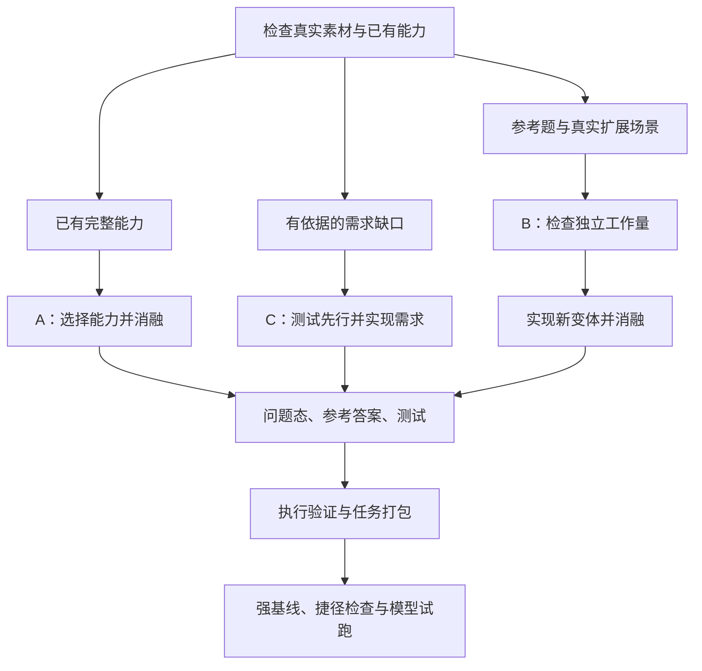

# DeepSWE 三条构题路线的素材来源与难度分析

更新日期：2026-10-26

分析对象：本仓库的 DeepSWE 风格构造器。RF 指南另行引用的 Datacurve DeepSWE 原题属于不同的材料来源。

DeepSWE 风格构题包含三条路线：A 从已有能力构造恢复题，B 从参考题演化变体，C 从真实需求构造开发题。三者的根本区别是工程工作量的来源。选定素材后，流水线负责组织问题态、参考答案、测试与任务包；实际难度需要通过强基线、捷径检查和模型试跑确认。

这里的 DeepSWE 是构题方法的名称。Refactor 通常要求保持外部行为、调整内部结构；恢复题要求补回缺失行为，需求开发题要求实现目标行为。任务类型与构造方法需要分别判断。

## 1. 三条路线的关系

| 路线 | 工作量从哪里来 | 作者主要做什么 | 最容易出现的问题 |
| --- | --- | --- | --- |
| A：已有能力恢复 | 真实软件已经实现的工程能力 | 选择连贯范围，移除实现，保留可解的上下文 | 移除代码很多，但恢复存在简单捷径 |
| B：参考题演化 | 参考题启发的新场景与新约束 | 寻找合理扩展点，完成新方案，再构造变体 | 换皮重复，原答案稍改即可复用 |
| C：需求驱动开发 | 真实仓库尚未满足的需求 | 明确契约，写测试，完成参考实现 | 需求缺乏依据，或已有现成解法 |



三条路线是可选择的构造方法，不是必须依次执行的三个阶段。以下各路线中的场景示例均用于解释方法；只有明确标为本地 demo 的内容对应仓库中的人工示例。

## 2. A 路线：从已完成的工程能力中提取恢复任务

### 2.1 核心思路

先选定一组真实、完整、可测试的能力，再移除其实现，让求解者依据公开契约和保留的上下文恢复能力。原实现提供一个已知可行解。

```text
真实、完整的能力
    → 确认接口、实现、依赖和测试
    → 选择一块连贯的工程范围
    → 移除实现，保留必要接口和周边功能
    → 得到问题态，并从完整态求出参考补丁
    → 验证恢复效果，形成任务
```

### 2.2 素材怎么找

素材来自已经做成的系统，例如查询引擎、协议实现、编译器子系统或增量分析模块。完整实现、公开接口和原生测试共同构成来源依据，不必要求曾经存在对应的 issue。

选材时先确认目标能力能运行、能验证，再判断其工程范围是否适合出题。来源可能带有其他历史缺陷，因此健康性检查应明确覆盖所选能力和受保护的回归范围。

### 2.3 为什么选择某片代码

先确定“恢复什么能力”，再沿公共入口、调用关系、数据流和状态依赖确定范围。选择的代码应共同完成一组可以说明、可以验证的行为。

例如，一个系统已有增量更新能力，涉及变更识别、依赖传播、缓存失效和结果重算。可以把这条工作链作为恢复目标，保留基础解析器、类型和公开接口。选择这些模块，是因为它们共同承载增量更新，而不是因为它们恰好位于一个大目录中。

消融后需要保留可构建性和可测试性，使求解者能够逐步恢复行为。把整个仓库破坏到无法收集测试，会失去有效的局部反馈。

### 2.4 难度从哪里来

难度来自原能力的算法、状态关系、异常路径和跨模块集成。还要检查合法替代方案能覆盖多少任务要求。

对于增量更新示例，如果“每次全量重算”已经满足公开契约，那么移除大量增量代码也不会自动制造难题。若真实场景需要性能保证，应把性能要求写成公开、可测的契约，并提供可达参考与可靠测量。

判断 A 路线时，应问：求解者必须补齐哪些能力？它们之间有什么依赖？一个通用补丁、现成依赖或简单重算是否足以覆盖全部要求？

### 2.5 如何构造和验证

用 F 表示完整态，E 表示消融后的问题态，S 表示参考答案，T 表示隐藏测试：

```text
E = 对 F 消融选定能力
S = E 与 F 在允许恢复的生产路径上的差异
T = 单独保存、由验证器安装的隐藏测试
```

S 由程序求差得到，生产实现和隐藏测试分别保存。验证应同时检查：E 的目标行为失败，应用 S 后目标行为通过，受保护的旧行为保持通过。编译或测试收集错误不能代替目标行为失败。

当前本地 A 路线支持 existing 测试模式；实现入口是 `Pipeline.ablation()`。[构造代码](../deepswe_factory/pipeline.py)，[消融提示](../deepswe_factory/prompts/ablate.md)。

## 3. B 路线：围绕参考题寻找有独立价值的演化场景

### 3.1 核心思路

参考题提供一种工程机制，例如优先级、状态转换、依赖传播或资源生命周期。作者据此寻找真实的新场景或新约束，判断它是否具有足够的独立工作量，再完成新方案并构题。

```text
参考题
    → 理解困难机制
    → 寻找真实的新场景或新约束
    → 判断原答案之外还剩多少独立工作
    → 完成新实现和测试
    → 消融目标能力，形成变体题
```

### 3.2 当前实现怎样获得素材

当前本地 B 路线接收已经指定的仓库、commit、生产路径、测试路径和参考题。程序要求参考题的 base commit 与候选输入一致，然后在该基线对应的仓库内寻找扩展点。自动跨仓库搜索和筛选新素材不在这条实现中。

分析 Agent 读取参考题及仓库证据，解释困难机制和具体扩展点；规划 Agent 在原问题态加参考测试 scaffold 上提出新需求。参考答案用于理解和验证，演化分支的起点仍是原问题态与参考测试。

规划提示要求返回以下内容：

| 字段 | 应当回答的问题 |
| --- | --- |
| `surface_gap` | 当前接口缺少什么具体行为？ |
| `transferred_mechanisms` | 新任务复用了参考题的哪种工程机制？ |
| `implementation_areas` | 哪些代码区域承接新需求，依据是什么？ |
| `test_plan` | 怎样观察目标行为并检验兼容性？ |

这些判断主要由 Agent 完成。当前 controller 检查若干计划字段非空，随后验证实现、补丁和测试；它没有独立判定需求价值与落点是否最佳。因此，前置选材和作者审查仍承担实质性的判断工作。[分析提示](../deepswe_factory/prompts/analyze.md)，[规划提示](../deepswe_factory/prompts/plan.md)，[实现代码](../deepswe_factory/pipeline.py) 中 `specialize()`。

### 3.3 为什么选择某片代码

应当建立一条明确的证据链：真实使用场景进入哪些公共接口，困难机制发生在哪里，结果影响哪些下游模块，以及当前缺少什么行为。代码范围由这条行为链决定。

例如，参考题涉及单请求重试，可以比较三种演化方向：

| 新候选 | 剩余工作与判断 |
| --- | --- |
| 给另一个接口加入同样的重试 | 可能主要是重复适配，原补丁容易复用 |
| 增加几个重试配置项 | 需求条目增加，但核心机制可能没有变化 |
| 为多步工作流实现部分成功后的恢复 | 若真实工作流涉及幂等、补偿、持久状态和资源回收，就可能形成独立任务 |

第三种候选成立的前提，是仓库确实存在这样的工作流及恢复需求。工作流状态、执行器、存储和清理逻辑因此成为实现范围。参考题可以提供部分经验，剩余设计与集成工作需要单独完成。

### 3.4 为什么原地改题容易重复

复用困难机制与复用原答案是两件事。在同一实现位置，围绕同一个功能再次改写、挖空，容易得到原题的近似变体。需要检查原补丁能直接覆盖多少新需求，以及剩余工作是否只是命名替换、重复适配或增加参数。

本地 demo 从“两份字典合并，子级覆盖父级”演化为“任意多层字典按顺序覆盖”。它是预先写好的人工 fixture，用于演示流水线。新增实现主要是一个循环，不能据此认为新题继承了参考题的难度，也不能把它视为自动发现素材的证据。[demo](../deepswe_factory/demo.py) 中 `DemoAgent.run()` 的 `plan` 和 `evolve` 分支。

### 3.5 难度与适用范围

B 的难度来自新场景引入的独立设计和实现工作。机制名称相同，不代表难度相同。构题后还需比较原答案的可复用程度、简单适配的效果与模型表现。

B 适合有依据的变体扩展、覆盖补充和机制对照。持续生产独立难题时，应先找到真实新场景，再判断是否适合借用参考题机制。若扩展点和独立工作量说不清，应将其保留为参考题变体。

## 4. C 路线：从真实需求构造开发任务

### 4.1 核心思路

先确定仓库尚未满足的具体需求，再用测试定义可观察行为，最后完成参考实现。求解者从原代码起步，实现同一需求。

```text
真实仓库与有依据的需求
    → 核对已有能力，确定真正缺口
    → 写成可观察、可测试的契约
    → 编写测试并确认旧代码因缺少目标行为而失败
    → 完成参考实现，检查新能力和旧功能
    → 将原代码作为求解起点，形成开发任务
```

### 4.2 素材怎么找

素材可以来自实际 issue、关联 PR、版本路线图、真实使用场景，或有代码与行为证据的能力缺口。首先核对已有实现、配置、插件和依赖，确定目标能力当前是否已经可用。

没有相关测试只能说明覆盖情况，不能直接证明功能缺失。需求缺口需要通过接口契约、实现分析和实际行为进一步确认。

### 4.3 为什么选择某片代码

代码范围来自需求影响分析：需求从哪里进入，经过什么状态与处理路径，最终产生什么可观察结果。

例如，假设批处理工具需要支持进程重启后继续执行未完成的工作。确认现有版本缺少该能力后，需要追踪：作业如何进入调度器，执行进度在哪里保存，输出何时算提交成功，重启后怎样区分已完成、未完成和状态不确定的工作。

这些关系决定要修改调度、状态存储、执行和结果提交中的哪些模块，也决定测试应该在哪里制造中断、观察恢复结果。工程范围随真实需求展开，而不是为了增加文件数而扩展。

### 4.4 难度从哪里来

难度来自真实需求中的相互约束，例如原子提交、重复执行、持久状态兼容和恢复顺序。若现成配置或已有依赖已经完整解决问题，实际剩余工作量就应据此下调。

C 要求作者既能说明需求，也能完成一个可信的参考实现。测试先行证明新旧行为有区别；需求价值、覆盖充分性与实际难度仍需各自的证据。

### 4.5 如何构造和验证

测试作者先编写目标测试，确认失败来自缺少目标行为；只读 critic 判断失败是否符合需求。实现作者随后修改生产代码，保留测试契约。需求语义发生变化时，需要重新检查下游测试和答案。

当前实现通过六项矩阵核对构建、目标行为和回归：

| 检查 | 代码状态 | 执行内容 | 期望 |
| --- | --- | --- | --- |
| C1 | 原代码 | 回归测试 | 通过 |
| C2 | 原代码 + 测试补丁 | 目标测试 | 因目标行为缺失而失败 |
| C3 | 原代码 + 参考答案 | 构建 | 通过，或明确不适用 |
| C4 | 原代码 + 参考答案 | 回归测试 | 通过 |
| C5 | 原代码 + 参考答案 + 测试补丁 | 目标测试 | 通过 |
| C6 | 原代码 + 参考答案 + 测试补丁 | 回归测试 | 通过 |

C6 检查测试补丁加入后是否影响旧功能，不能由 C4 替代。报告缺失、测试收集失败、跳过或超时需要单独处理。[复现说明](../docs/factory_reproduction.md) 的“DeepSWE 输入与路线”，[实现代码](../deepswe_factory/pipeline.py) 中 `forward()` 和 `matrix()`。

## 5. 如何按素材选择路线

对于真实、独立、工程量大的 SWE 题，建议根据素材状态选择方法：

- 已经存在成熟、完整、值得恢复的能力：优先考虑 A。
- 存在明确而尚未完成的工程需求：优先考虑 C。
- 已有参考题，同时找到有独立价值的新场景：考虑 B，并检查原答案的可复用程度。

每个候选都应能回答以下问题；答案用于指导补充证据和调整范围：

1. 需求或完整能力的真实来源是什么？
2. 当前起点已经能做什么，缺少什么？
3. 为什么选择这些代码区域，它们如何共同实现目标行为？
4. 求解者还需要完成哪些独立的设计、实现与集成工作？
5. 现成依赖、原生路径、简单配置或通用补丁能覆盖多少要求？
6. 参考答案、测试和试跑分别支持什么结论？

目标测试的失败到通过（F2P）用于确认缺失行为被补齐；回归测试的通过到通过（P2P）用于确认旧行为得到保留。两者通过能够建立有限的功能验证依据，任务难度还需模型轨迹与实际得分支持。

## 6. 当前目录与实现边界

`task_factory/` 保存具体构造配方、参考组件和路线配置。通用 DeepSWE 三路线实现位于 `upstream/swe-factory/deepswe_factory/`。`task_factory/assemble.py` 没有直接调用整套 DeepSWE 流水线。

当前本地实现中，A 使用 existing 测试模式；B 是单参考的 Base 验证加一次演化；C 是单 query 与共享修复预算。B 的计划选择主要依赖 Agent，跨仓库素材检索与独立需求价值审查需要前置工作。具体实现差异见[复现说明](../docs/factory_reproduction.md)的“与规格的边界”。

通用构造器通过内部验证后记录 `internally_verified/L2`，并保留 `accepted=false`、`outer_harbor_verified=false`。任务构造、内部运行验证、目标平台验证和难度标定是不同证据层。这里的代码分析没有新增构题运行或难度测量。

## 7. 代码与文档入口

| 来源 | 对应内容 |
| --- | --- |
| `edgebench/task_factory/README.md`（外层项目） | 当前目录的构造与打包职责 |
| `edgebench/task_factory/swe_routes.json`（外层项目） | M1 产品演进、M4 跨模块恢复等用途映射 |
| [DeepSWE 构造规格](../deepswe.md) | 第 5、6、7 节分别描述 A、B、C |
| [本地复现说明](../docs/factory_reproduction.md) | 输入契约、执行矩阵与实现边界 |
| [Pipeline](../deepswe_factory/pipeline.py) | `ablation()`、`specialize()`、`forward()` 与 `matrix()` |
| [分析提示](../deepswe_factory/prompts/analyze.md) | 真实入口、机制和路径证据 |
| [演化规划提示](../deepswe_factory/prompts/plan.md) | 需求缺口、机制迁移和实现区域 |
| [人工 demo](../deepswe_factory/demo.py) | 两层合并到多层合并的固定示例 |
